# Archi security design

This document describes the security boundaries and extraction controls in
Archi 0.6.x. It is a description of the current implementation, not a claim of formal verification or an independent
security audit.

Report suspected vulnerabilities privately as described in
[`SECURITY.md`](../SECURITY.md).

## Goals and threat model

Archi treats archive bytes, entry names, declared sizes, links, engine output,
and extracted files as untrusted. Its extraction design aims to:

- prevent archive entries from escaping the selected destination;
- never recreate a link from an archive, and reject special files, ambiguous
  names, and portable path collisions;
- bound entry count, path depth, and expanded output;
- keep unvalidated payload files away from the destination;
- avoid replacing the source archive or silently overwriting existing files;
- avoid launching executable archive entries through Open or Quick Look; and
- leave the original archive recoverable when a modification fails.

Archi trusts the installed application, the operating system, the current user
account, and its bundled 7-Zip executable. The 7-Zip process is a child process,
not an operating-system sandbox: a vulnerability in 7-Zip could execute before
Archi validates its output.

## Trust boundaries

- **WebView UI:** displays archive metadata, loaded a page at a time, and
  progress. Archive processes, filesystem traversal, validation, and
  installation run in Rust. Tauri grants the main window a narrow set of event,
  window-drag, file-dialog, notification, and drag permissions.
- **Bundled engine:** 7-Zip reads untrusted archives and produces technical-list
  text or extracted files. Archi treats both as untrusted inputs.
- **Private staging:** extraction output is written to a job-owned staging
  directory and is not installed in the selected destination until validation
  succeeds.
- **Destination filesystem:** existing names, links, filesystem semantics, free
  space, permissions, and extended-attribute support are outside Archi's
  control and are checked where the operation requires them.

## Extraction pipeline

```mermaid
flowchart LR
    A[Untrusted archive] --> B[7-Zip technical listing]
    B --> C[Parse and validate declared entries]
    C --> D[Extract non-link entries into job-owned staging]
    D --> E[Monitor actual output limits]
    E --> F[Write hard links as copies]
    F --> G[Validate the staged filesystem tree]
    G --> H[Preflight conflicts and source overlap]
    H --> I[Move validated files into the destination]
```

1. **List before extracting.** Rust invokes the bundled engine and parses its
   technical listing. Lines that cannot be represented by the protocol are
   rejected rather than guessed. A compressed tarball (`.tar.gz`, `.tar.bz2`,
   `.tar.xz`, `.tar.zst`) is listed by piping the decompressed stream into a
   second engine process that reads the TAR; no intermediate file is written.
   Listing runs as a job the user can cancel.
2. **Validate declared metadata.** Paths must be relative, composed of safe
   components, and no deeper than 100 components. Names are compared using
   Unicode normalization and case folding so entries that would collide on
   common filesystems are rejected. The declared entry ceiling is 1,000,000.
   Names that only Windows cannot represent (reserved device names, a colon, a
   trailing dot or space) are rejected on Windows builds only; on macOS they are
   ordinary file names. A `C:\` or `C:/` drive path is rejected everywhere.
3. **Take links out of the request.** Link entries are excluded from validation
   and from what the engine is asked to extract, so the engine is never asked to
   create one. A symbolic link is skipped and counted in the result. A hard link
   is resolved against the listing: when it names a regular file in the same
   archive it is recorded to be written as a copy in step 6, and otherwise it is
   skipped. A selection that contains only skipped links is refused.
4. **Check declared expansion.** The selected entries' declared sizes are
   compared with the configured expanded-size limit. Unknown or excessive
   totals require explicit user approval.
5. **Extract into staging.** 7-Zip writes into a job-owned payload directory.
   Entries are named to the engine in a private list file with wildcard matching
   disabled, so names are matched literally and a large selection cannot
   overflow the command line. Cancellation or a limit failure terminates the
   child process. While extraction is active, Rust periodically walks staging
   and terminates extraction if actual file bytes exceed the configured limit;
   the same measurement drives the progress display. The final output is
   checked again after the engine exits.
6. **Write hard links as copies.** For each recorded hard link, Archi itself
   copies the staged file it names to the link's path inside staging. Both paths
   are resolved through the same safe-component rules, the source must be a
   regular file with a single link, and the destination must not already exist.
   A file extracted only to be copied from is then removed. The size limit is
   enforced again afterwards.
7. **Validate actual output.** Archi inspects the staged filesystem tree rather
   than trusting the listing. Symbolic links, hard links, special files,
   non-Unicode paths, unsafe components, excessive depth, excessive entry count,
   and normalized collisions are rejected. This check is independent of step 3:
   if the engine created a link despite not being asked to, extraction fails.
8. **Preflight the destination.** Archi resolves conflicts before installation,
   refuses to replace the source archive, and applies the selected Ask, Replace,
   Skip, or Keep Both policy.
9. **Install files.** Each validated regular file is moved from staging to its
   final name with a rename that refuses to replace an existing file.
   Replacement first moves the existing file to a backup and restores it if the
   move fails. When a rename is not possible, the file is copied to a temporary
   file beside its destination and then given its final name.

Creating the destination directory itself may occur before the final commit,
but archive payload files are not installed until the preceding checks pass.

### Where staging lives

Staging is placed on the volume that will receive the result so that step 9 is
a rename rather than a second write. When the destination shares a volume with
the system temporary directory, staging is a private directory there. Otherwise
it is a hidden `.archive-app-extract-…` directory created beside the
destination, with a locked record in the system temporary directory. Both are
removed when the job ends. At launch, Archi removes stale records and, through
them, any hidden staging directory a crashed job left behind; the recorded path
is only removed if it has Archi's prefix, is a real directory, and contains
Archi's marker file. Entry names that begin with either staging prefix are
rejected in step 2.

### Filesystems without an exclusive rename

exFAT and FAT volumes cannot rename a file while refusing to replace an existing
one. On those volumes Archi checks that the final name is free and then renames.
The check and the rename are not atomic, so a file created at that exact name by
another program in between would be replaced. The preflight in step 8 has
already established that the name was free moments earlier.

### One-step extraction from Finder

Extract Here, Extract to Folder, and a dropped batch of archives use the Keep
Both policy and, when an archive has more than one top-level item, install into
a new folder named after the archive so its contents never mix with the folder's
other files.

## Passwords

Passwords are sent to the engine on standard input. Archi refuses to start the
engine if its arguments contain an inline password switch. Rust holds passwords
in zeroizing buffers for the duration of the operation.

So that the user is not asked repeatedly, the window keeps the accepted password
for the archive it has open in memory until that archive is closed, another is
opened, or Archi quits. It is never written to settings, history, diagnostics,
or disk, and is discarded if the engine later rejects it. Passwords for archives
handled from Finder without being opened are used for that operation only.

## Archive creation and modification

A new archive is built in a staging directory on the output's volume, tested,
listed, validated, and then moved to its final name. An existing file at the
chosen name is replaced only when the system save panel confirmed it. An
existing split-volume set is replaced only after a separate confirmation: every
numbered part of the old set is moved aside first and restored if the new set
cannot be installed.

Add, delete, rename, and comment operations work on a temporary copy beside the
source archive. Archi records the source fingerprint, validates the rewritten
archive, and refuses replacement if the source changed meanwhile. Commit keeps
a backup, replaces by rename, synchronizes the new archive and its parent
directory, and restores the original when replacement cannot be made durable.
If recovery cannot be completed automatically, the error reports the path of
the recoverable rewritten archive. A cancelled modification deletes its
temporary copy.

Items are added beneath the archive folder being browsed. Because the engine
stores each input under its path relative to its working directory, Archi gives
it a private directory that contains that folder, with a symbolic link to each
top-level input. The engine follows those links and stores file contents; the
inputs themselves were enumerated beforehand with symbolic links excluded, and
the result is checked to contain every added item at its expected path and no
link. Replacing an existing file requires confirmation, and a file may not take
the name of an existing folder or the reverse.

## Quarantine propagation

On macOS, Archi copies `com.apple.quarantine` from a quarantined source archive
to staging output, installed files, previews, dragged-out files, and rewritten
archives. If a filesystem explicitly reports that extended attributes are
unsupported, Archi continues because that filesystem cannot store the attribute.
Permission, read-only, storage, and other I/O failures remain fatal.

Quarantine is an operating-system warning mechanism, not malware detection. An
archive or file without a quarantine attribute does not acquire one from Archi.

## Open, Quick Look, and drag-out

Open and Quick Look extract one selected entry to an owner-only preview cache.
The entry must be a regular file with a declared size within the configured
preview limit. Archi validates the extracted output and rejects directories,
symbolic links, special files, executable extensions, executable permission
bits, scripts, Mach-O files, PE files, ELF files, and Java archives. A hard link
is opened as the file it names, under the same rules. File contents are not sent
through the WebView, and the preview copy is owner-only.

Dragging an entry to Finder is an extraction of one file, not an Open. It uses
the extraction size limit rather than the preview limit, allows scripts and
executables, and keeps the archived permissions. The copy carries the archive's
quarantine attribute, and Archi never launches it.

Preview and drag-out copies are removed when Archi quits and again at the next
launch.

These restrictions apply to Open and Quick Look. They do not prevent users from
extracting an executable file and launching it themselves.

## Finder requests and quitting

Finder Services pass selections through private, owner-only request files that
are validated, consumed once, and deleted. A request Archi refuses is shown to
the user rather than dropped. Finder actions run on the archives they name and
do not change the archive open in the window.

While a job is running, Quit, logout, and closing the window are refused until
the user chooses to stop the job. A job that is already installing its result is
allowed to finish first.

## Limits of this design

Archi does not claim to:

- sandbox or eliminate vulnerabilities in 7-Zip, macOS, Tauri, WebKit, or other
  dependencies;
- classify malware, scan extracted files, or guarantee that a non-executable
  document is safe for another application to open;
- prevent resource exhaustion during archive listing or when a user explicitly
  approves unbounded extraction;
- install a file atomically without replacement on filesystems that offer no
  exclusive rename;
- preserve every ACL, owner, extended attribute, hard-link relationship, or
  platform-specific metadata across every archive format and destination
  filesystem; or
- make weak archive passwords cryptographically strong.

The signed and notarized release, hardened runtime, restrictive Content
Security Policy, and narrow Tauri capabilities reduce other application risks,
but they do not turn the 7-Zip child process into an App Sandbox boundary. See
the current [`KNOWN_LIMITATIONS.md`](KNOWN_LIMITATIONS.md) for product-level
limitations.

## Implementation evidence

Controls are named by function and test rather than by line number, which goes
stale as the code changes.

| Control | Source | Tests |
| --- | --- | --- |
| Extraction orchestration and declared-size gate | `start_extract`, `validate_expansion` in [`commands.rs`](../src-tauri/src/commands.rs) | `password_confirmation_selected_totals_and_expansion_limits_are_enforced` in `commands.rs` |
| Engine listing and strict technical-list parser | `parse_slt`, `inspect_archive` in [`archive.rs`](../src-tauri/src/archive.rs) | `parses_technical_listing_without_losing_equals_or_unicode`, `rejects_multiline_names_in_text_protocol` in `archive.rs` |
| Compressed-tarball listing and extraction through a pipe | `spawn_tar_list`, `spawn_extract_entries` in [`archive.rs`](../src-tauri/src/archive.rs); `run_inspect` in [`jobs.rs`](../src-tauri/src/jobs.rs) | `tarballs_are_browsed_and_extracted_without_their_links` in `commands.rs` |
| Path, depth, entry-count, and collision validation | `validate_archive_entries`, `safe_components` in [`safe_paths.rs`](../src-tauri/src/safe_paths.rs) | [`security.rs`](../src-tauri/tests/security.rs) |
| Link exclusion and hard links written as copies | `without_links`, `hard_link_target` in [`commands.rs`](../src-tauri/src/commands.rs); `materialize_hard_links` in [`safe_paths.rs`](../src-tauri/src/safe_paths.rs) | `hard_links_are_extracted_as_their_own_copies`, `tarballs_are_browsed_and_extracted_without_their_links` in `commands.rs`; `rejects_links_created_in_staging` in `security.rs` |
| Literal entry selection through a list file | `prepare_extraction`, `extract_switches` in [`archive.rs`](../src-tauri/src/archive.rs) | [`security_hotfix.rs`](../src-tauri/tests/security_hotfix.rs); `tarballs_are_browsed_and_extracted_without_their_links` in `commands.rs` |
| Mid-extraction output monitoring and process termination | `run_extract`, `JobControl::wait` in [`jobs.rs`](../src-tauri/src/jobs.rs); `enforce_staging_limits` in [`safe_paths.rs`](../src-tauri/src/safe_paths.rs) | `extraction_limits_use_actual_files_and_reject_deep_paths` in `safe_paths.rs`; `child_process_can_be_cancelled` in `archive.rs` |
| Staging placement, crash cleanup, and move-into-place installation | `StagingDirectory::create_near`, `cleanup_stale_staging`, `commit_staging`, `install_file` in [`safe_paths.rs`](../src-tauri/src/safe_paths.rs) | `staged_files_are_moved_into_place_and_staging_beside_a_target_is_cleaned_up` in `safe_paths.rs`; [`security.rs`](../src-tauri/tests/security.rs) |
| Password transport | `spawn_command`, `write_password` in [`archive.rs`](../src-tauri/src/archive.rs) | `rejects_passwords_in_process_arguments`, `accepts_passwords_that_appear_in_arguments_or_archive_names`, `encrypted_round_trip_uses_stdin_password` in `archive.rs` |
| Atomic, recoverable archive rewrite | `ArchiveRewrite` in [`safe_paths.rs`](../src-tauri/src/safe_paths.rs) | `archive_rewrite_replaces_atomically_and_detects_external_changes` in `safe_paths.rs` |
| Additions into an archive folder and replacement rules | `prepare_addition`, `relocate_plan` in [`archive.rs`](../src-tauri/src/archive.rs); `check_addition` in [`commands.rs`](../src-tauri/src/commands.rs) | `additions_land_in_the_chosen_folder_and_replace_only_when_confirmed` in `commands.rs` |
| Created-archive installation and split-volume replacement | `install_created_archives`, `existing_volumes` in [`safe_paths.rs`](../src-tauri/src/safe_paths.rs) | `created_archive_replaces_only_a_confirmed_existing_file`, `replacing_a_split_archive_retires_the_whole_old_set` in `safe_paths.rs` |
| Quarantine propagation with unsupported-filesystem fallback | [`quarantine.rs`](../src-tauri/src/safe_paths/quarantine.rs) | `quarantine_survives_rewrite_preview_and_staged_commit` in `safe_paths.rs` |
| Preview validation, executable blocking, and drag-out rules | `validate_preview_entry`, `persist_preview_file` in [`safe_paths.rs`](../src-tauri/src/safe_paths.rs) | `preview_copy_is_private_scoped_and_executables_are_rejected`, `dragged_entries_follow_extraction_rules_not_preview_rules` in `safe_paths.rs` |
| Finder request validation and visible refusals | [`shell_requests.rs`](../src-tauri/src/shell_requests.rs) | tests in `shell_requests.rs` |
| Quit and close guard while a job runs | `quit_guard` in [`lib.rs`](../src-tauri/src/lib.rs); `archive_app_install_quit_guard` in [`archive_services.m`](../src-tauri/macos/archive_services.m) | No automated test |
| WebView Content Security Policy and Tauri permissions | [`tauri.conf.json`](../src-tauri/tauri.conf.json), [`default.json`](../src-tauri/capabilities/default.json) | CI configuration: [`ci.yml`](../.github/workflows/ci.yml) |

Security documentation must change when these controls or their boundaries
change. Passing tests demonstrates the tested behavior; it is not a substitute
for external review or vulnerability reporting.
